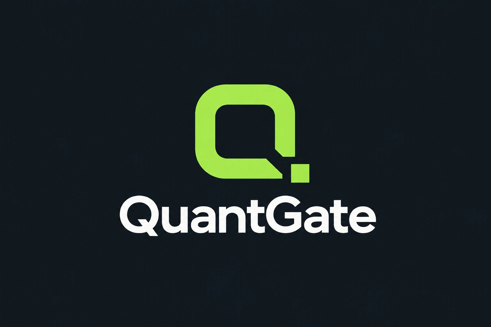
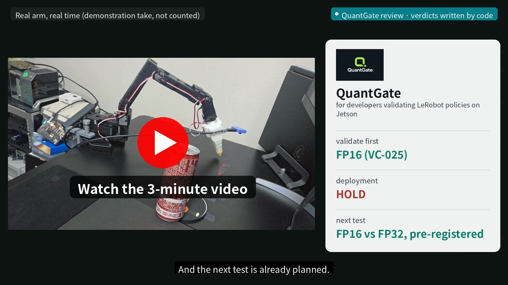
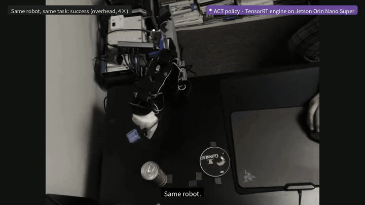
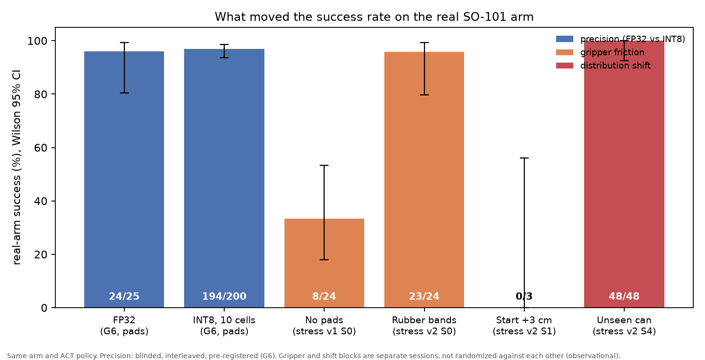
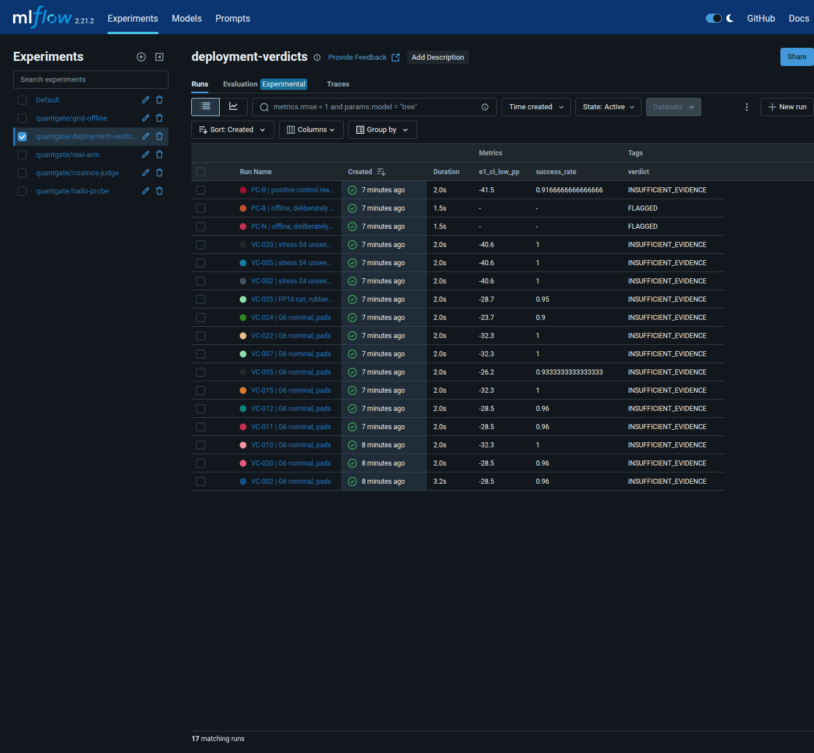

<p align="center"></p>
<p align="center">
  <a href="https://github.com/goodboychan/nebius-physical-ai/actions/workflows/ci.yml"></a>
  <a href="LICENSE"></a>
  
  <a href="https://www.youtube.com/watch?v=z80w9vig-qA"></a>
  <a href="https://claude.ai/artifact/2tUAoJHBeT8uLU96BmgPNK"></a>
  <a href="https://huggingface.co/datasets/chans/quantgate-so101-coaster"></a>
  <br>
  
  
  
  
</p>

<p align="center">
  <a href="https://www.youtube.com/watch?v=z80w9vig-qA"></a>
</p>
<p align="center"><br>
<sub>Same robot, same task: one run succeeds, one fails. Move the can 3 cm and it misses (overhead camera, 4×).</sub></p>

# QuantGate — a robot deployment review

*Why a can on a coaster?* It started as a small gesture: an arm that brings a drink to someone working hard.
Setting it down properly on the coaster turned out to be the hard part.

**Evidence before deployment.** QuantGate helps robot developers decide which precision of a policy to ship on an
edge device. It shows the engine's measured cost, its real-arm behavior and how strong the evidence is.

> QuantGate screens INT8 robot policies offline on Nebius and gates which ones reach a Jetson-powered SO-101 arm.
> Cosmos-Reason2 watched the real runs (215 live, 245 retrospectively) and Nemotron writes the deployment report. The whole real-arm study was
> pre-registered, operator-blinded and hash-sealed in the main study; follow-ups were sealed and interleaved, with
> partial operator blinding in the fine-tune blocks (caveats under Limitations).

**License: [Apache 2.0](LICENSE)** · Nebius × NVIDIA Global AI Hackathon, Physical AI track · internal code name
`edgeqgate`

**Video (3 min):** https://www.youtube.com/watch?v=z80w9vig-qA · **Dashboard:** https://claude.ai/artifact/2tUAoJHBeT8uLU96BmgPNK

**Links** · Datasets on the Hugging Face Hub (LeRobot v3):
[`chans/quantgate-so101-coaster`](https://huggingface.co/datasets/chans/quantgate-so101-coaster) (120 teleoperated
demonstrations) · [`chans/quantgate-so101-coaster-positions`](https://huggingface.co/datasets/chans/quantgate-so101-coaster-positions)
(50 demonstrations at shifted start positions, used for the position fine-tune) ·
[`chans/quantgate-so101-coaster-positions-v2`](https://huggingface.co/datasets/chans/quantgate-so101-coaster-positions-v2)
(50 demonstrations with the yellow can and far starts, used for fine-tune v2). How each one trained a policy and where
it was evaluated: [Data and lineage](#data-and-lineage).

The logo's Q stands for QuantGate and quantization. The open passage at the lower right is the gate, and the small
square leaving it is a candidate that has cleared review for its next test. Passing the gate means "worth
validating next", not "approved": in this study no INT8 build was approved against FP32 (insufficient evidence).

## What is new here

A gate in front of deployment, or a model that proposes while code decides, is not new on its own. What QuantGate adds
is the combination, measured on a real arm:

1. **The same policy, compared across its deployable builds.** FP32, FP16 and 24 INT8 calibrations of one checkpoint,
   with cost measured on the Jetson and behaviour measured on the arm, side by side.
2. **Physical causes kept apart from the build.** Grip friction, the start position, a smaller can and a knocked wrist
   camera are tracked as deployment conditions, so a failure is not blamed on the precision by default.
3. **A fix that was checked, twice.** Failure found → new demonstrations → fine-tune → sealed comparison at conditions
   never in training, then the same again for the gaps the first fix left.
4. **The line between "better" and "approved".** An improvement, a cheaper build or a passing check is reported as what
   it is; deployment stays HOLD until the pre-registered rule says otherwise.

## Judge your own results

Bring the success counts of your own builds, and QuantGate reads them with the same rules this study used (Newcombe
intervals, a 10 pp tolerance, the ceiling clause or the revised rule, and the sample-size plan):

```bash
.venv/bin/python scripts/quantgate.py judge examples/my_results.csv             # the study's rule, with the ceiling clause
.venv/bin/python scripts/quantgate.py judge examples/my_results.csv --rule revised
```

One row per comparison: `candidate, reference, cand_successes, cand_trials, ref_successes, ref_trials`, optionally
`gpu_ms, energy_mj, placement_ok, preflight_ok, mode (improvement), assumed_rate`. Each row gets a deployment decision
(GO / HOLD / BLOCK), the evidence finding, why, and the next test with trials per arm. A GO needs the success criterion,
the placement check and the preflight; an improvement alone is never a GO. The first example row is this study's FP16
result and reproduces its reading (19/20 vs 10/10: degradation 5.0 pp, 97.5% interval [−28.7, +27.3], HOLD).

## Quickstart: one command for the review

```bash
uv venv .venv && uv pip install --python .venv/bin/python -e ".[dev]"
.venv/bin/python scripts/quantgate.py verify          # tests, runner harness, 22 sealed logs vs their post-lock hashes
.venv/bin/python scripts/quantgate.py review --no-llm # verdict table, next-test plans, the full review as one HTML file
                                                      # (artifacts/reports/review_report.html), preflight demo, review cost
.venv/bin/python scripts/quantgate.py plan FT-FP16    # from evidence to the next test: confirmed, open, evidence, plan
NEBIUS_API_KEY=... .venv/bin/python scripts/quantgate.py review   # + D3 report v3 by Nemotron on Token Factory, dashboard
NEBIUS_API_KEY=... .venv/bin/python scripts/quantgate.py ask "Can I use the fine-tuned policy where the start varies?"
.venv/bin/python scripts/quantgate.py stages          # the robot and cloud stages that produce the evidence
```

The review layer is deterministic: re-running it on the committed evidence reproduces the committed outputs. No robot,
GPU or API key is needed to open the whole review: `review --no-llm` writes `artifacts/reports/review_report.html`, and CI
rebuilds it on every push. The dashboard's "From evidence to the next test" section shows the same plans per candidate.

## Results at a glance

<p align="center"></p>

Numbers come from committed artifacts. The figure's script lists its sources.

1. **No success advantage from INT8 calibration choice was detected in this regime.**
   - FP32 succeeded 24/25. The 10 INT8 cells tested succeeded 194/200.
   - Audit-selected vs random cells: 73/75 vs 73/75. The difference is 0.0, 95% CI [−6.8, +6.8] pp.
   - The same cell re-measured on another day had a wider CI, [−19.5, +12.4] pp.
   - The offline rank did not predict placement: Spearman 0.02–0.08.
   - This is reported as *no difference detected*.
   - Against FP32, every INT8 cell is also *insufficient evidence* at a 10 pp tolerance. The Newcombe intervals are
     too wide at these sample sizes ([`g6_q2_sensitivity.json`](artifacts/reports/g6_q2_sensitivity.json)).
   - Sources: [`g6_analysis.json`](artifacts/reports/g6_analysis.json),
     [`g6_supplement.json`](artifacts/reports/g6_supplement.json).
2. **On the Orin Nano Super (15 W), FP16 is the cost-favored candidate.**
   - GPU compute: FP16 11.6 ms, INT8 16.8–17.1 ms, FP32 53.4 ms.
   - Energy per inference: 82, 101 and 403 mJ.
   - On the real arm FP16 succeeded 19/20, against FP32 10/10 and INT8 10/10 (one interleaved blinded session).
     Placement was within tolerance of FP32 (−0.63 px, CI [−2.64, +1.37]). Success: insufficient evidence at this
     sample size. End to end it took 24.7 ms per chunk, against 34.3 ms for INT8 and 79.0 ms for FP32
     ([`fp16_analysis.json`](artifacts/reports/fp16_analysis.json)).
   - Source: [`power_bench/SUMMARY.md`](artifacts/reports/power_bench/SUMMARY.md).
3. **Deployment margins mattered more than precision** (observational).
   - Without the gripper pads: 8/24. With rubber bands: 23/24.
   - In a small test with the start spot moved 3 cm: 0/3 (stopped after 3 trials). The arm first reached toward the trained
     start spot. Item 5 follows this up.
   - An unseen yellow can: 48/48, all four engines 12/12. Placement was within the 5 px tolerance of FP32 for every
     INT8 cell ([`stress_v2_analysis.json`](artifacts/reports/stress_v2_analysis.json)).
   - Source: [`stress_operator_notes.md`](docs/sessions/stress_operator_notes.md).
4. **The AI judge was validated and improved, within limits.**
   - In its first setup (final frame, one-word answer) Cosmos-Reason2 caught 1 of 21 failures on a held-out set.
   - After a dev/eval-split re-evaluation, a final-frame prompt with an explicit success criterion and an `Answer:` format caught **20/21** failures (Wilson 95% 0.77–0.99) with **5/252** false alarms on the same held-out set.
   - The false alarms concentrate on the unseen yellow can (4/33, 12%).
   - The setup is very sensitive to wording, the change combined prompt, format and token budget, and it judges only the end state (median 893 ms).
   - **Live, prospective re-check**: the same prompt, unchanged, ran on 96 new fine-tune trials (T1, T0, T2 and the
     T0R replication). It caught **22/24** failures (0.74–0.98) with **2/72** false alarms ([`ft_cosmos_live_judge.json`](artifacts/reports/ft_cosmos_live_judge.json)).
     Other objects and scenes are still open.
   - Source: [`cosmos_judge_eval_preregistration.md`](docs/cosmos_judge_eval_preregistration.md), [`eval_scores.jsonl`](artifacts/cosmos_judge/eval_scores.jsonl).

5. **The position weakness was found, fixed and re-tested under a pre-registered rule.**
   - Data and training: 50 new teleoperated demos at −4, −2, 0, +2 and +4 cm. A 20k-step fine-tune from the same
     checkpoint on Nebius Jobs (L40S, 1,489 s). The FP16 engine cost is unchanged.
   - Evaluation: blinded and interleaved, 12 vs 12 per position, against the old policy, at positions not in
     training.

     | Start position | Fine-tuned | Old | FT − old, Newcombe interval | Pre-registered reading |
     |---|---|---|---|---|
     | **+3 cm** (primary) | **12/12** | 3/12 | +75 pp [+38, +91] at 95% (improvement: lower bound > 0) | improvement detected |
     | **−3 cm** (symmetry, added during the session and registered before any unsealing) | **10/12** | 2/12 | +67 pp [+27, +84] at 95% | improvement detected |
     | 0 cm (training mark) | 10/12 | 12/12 | −17 pp [−49, +15] at 97.5% (non-inferiority, 10 pp tolerance) | insufficient evidence |
     | 0 cm, replication T0R (registered after T0, §15) | 12/12 | 11/12 | pooled 22/24 vs 23/24: −4 pp [−25, +16] at 97.5% | T0 failures not repeated; still insufficient evidence |

   - Reading: position improved on both sides of the trained start. Whether nominal performance is maintained is
     undetermined. A pre-registered replication at the training mark (T0R) did not repeat the two fine-tune failures.
   - **Generalization, pre-registered as amendment 7 and run after the results above**: FT against old, 12 trials
     each, sealed and interleaved.
     - A held-out object at a held-out position (yellow can at +3 cm, primary): **0/12 vs 3/12**, −25 pp [−53, +4];
       no improvement detected. Every FT failure was in the grasp.
     - Beyond the demonstrations: **+6 cm 0/12 vs 0/12** (not detected); **−6 cm 8/12 vs 0/12**, +67 pp [+30, +86]
       (detected).
     - Reading: the fix carries to −6 cm but not to +6 cm or to the smaller can. FT is the candidate where the start
       varies between −6 and +3 cm with the cola can, not a general fix.
     - **Re-test without a scene deviation (amendment 8)**: small red markers had been next to the can in those
       blocks, and the wrist camera had been knocked off-axis. With both restored: **+6 cm 0/12 vs 0/12** and **yellow
       can 0/12 vs 0/12** (no improvement detected; flagged because a health check read the scene as "unclear"). The
       +6 cm reading stands. On the yellow can the old policy lost its 3 successes; which restored change mattered
       cannot be separated. The wrist camera seems to have shifted again early in the re-tests, so the restored view did not hold
       throughout (hardware note in the pre-registration §20).
     - **Fine-tune v2 closed both gaps (amendment 9)**: 50 more demonstrations (the yellow can at −4…+4 cm, the cola
       can at +5 and +7 cm), with the wrist mount fixed. Against FT, sealed and interleaved, 12 each: **yellow can at
       +3 cm 12/12 vs 7/12**, +42 pp [+9, +68]; **+6 cm 12/12 vs 2/12**, +83 pp [+46, +95]; both improvements detected,
       at conditions never in training. A guard at the training mark found no drop (12/12 vs 12/12).
     - FT itself did better in this session than before (7/12 and 2/12 against 0/12), so part of the earlier gap was the
       scene. FT2 is the next candidate for these conditions, not an approval.
   - Off the training position, the old policy's commanded gripper also chatters about 4× more (exploratory,
     pre-specified metric).
   - Caveat: the operator could see that the two policies moved differently, so operator blinding was partial.
     Outcomes come from the automatic judge and the video re-judge, which agree block by block.
   - Sources: [`finetune_position_preregistration.md`](docs/finetune_position_preregistration.md) §14,
     [`ft_analysis.json`](artifacts/reports/ft_analysis.json).

Stress tests were unsealed on 2026-10-13. The stress protocol is
[`docs/stress_test_protocol.md`](docs/stress_test_protocol.md).

**What the review cost** ([`review_cost.md`](artifacts/reports/review_cost.md), from committed records at list prices):

| | Use | USD |
|---|---|---|
| Nebius Jobs | ACT training and fine-tune on L40S (2.5 h); 48 CPU audit jobs | 4.5 |
| Nebius AI Endpoint | Cosmos-Reason2 on L40S, 11 sessions, 16.5 h up | 25.6 |
| Nebius Token Factory | Nemotron 3 Super, 68+ calls, 150k in / 86k out tokens (lower bound) | 0.1 |
| Nebius Managed MLflow | 1.5 h | 0.7 |
| **Cloud total** | | **≈ 31** |

- The real arm ran 745 trials in about 18.6 operator-hours.
- For scale, not as a saving: settling approval for all 25 candidates and FP32 at about 115 trials per arm would be
  about 2,990 trials and about 74 arm-hours, before any stress or position test. The two numbers answer different goals.
- The review did not settle approval. It ranked what to validate first, blocked broken builds, found and fixed a
  weakness, and listed the trials still missing.

## How QuantGate uses NVIDIA models and Nebius

| Component | What runs | Where |
|---|---|---|
| Deployment target | LeRobot ACT policy (51.6M) as **TensorRT** FP32 / FP16 / INT8 engines | **Jetson Orin Nano Super** (TensorRT 10.3) next to a real SO-101 arm |
| Quantization | NVIDIA **TensorRT Model Optimizer** (modelopt) INT8 Q/DQ, 24 calibration variants | NGC PyTorch 25.11 container, local GPU |
| `D4` runtime supervisor | **`nvidia/Cosmos-Reason2-2B`** watches the overhead camera at 2 Hz (CONTINUE / FALLBACK / ABORT, shadow mode) and is asked at trial end whether the task succeeded | **Nebius AI Endpoint** (L40S, vLLM 0.29), about 330 ms round trip from the robot |
| `D3` deployment report agent | **`nvidia/nemotron-3-super-120b-a12b`** writes only the explanation and open questions of a report whose verdicts, numbers and status are all written by code; code rejects digits, verdict labels, approval words and known misreadings in the model text (report v3; v2 kept as history) | **Nebius Token Factory** |
| `D3` ask the review | **Nemotron 3 Super** answers a developer's question. It picks the verdict-table rows that bear on it, and code prints their verdicts and numbers. The model explains in words only, checked like report v3; rows the question names are added by code ([`quantgate_ask.py`](scripts/quantgate_ask.py), [examples with a human review](artifacts/reports/ask_examples.md)) | **Nebius Token Factory** (structured output) |
| `D5` errata collector | **Tavily** search for TensorRT / Jetson / INT8 known issues, with queries derived from the real build environment and snapshot-hashed | Tavily API |
| `D5` errata grounding | **Nemotron 3 Super** labels each of the 25 field reports against our measured facts (matches / contrasts / applies but unverified / not applicable) with structured output; code checks that every quote is verbatim, and the report shows only those quotes and our own facts, never the model's numbers ([`errata_grounded.md`](artifacts/reports/errata_grounded.md), [pre-registration](docs/errata_grounding_preregistration.md)) | **Nebius Token Factory** |
| Policy training | LeRobot 0.6.1 ACT, 100k steps | **Nebius Jobs** (L40S, 1 h 57 min) |
| Position fine-tune | 50 shifted demos, 20k steps from the same checkpoint | **Nebius Jobs** (L40S, 25 min) |
| Audit fan-out | 25 cells × bootstrap scoring on 2,000 held-out states | **Nebius Jobs** (CPU) |
| Data and weights | demos, checkpoints, Cosmos weights | **Nebius Object Storage** (S3) |
| Simulation twin (exploratory) | the SO-101 task in **Isaac Sim 6.2**, calibrated to the real arm, replaying real trials ([`sim/README.md`](sim/README.md)) | GB10 desktop (local) |
| Experiment record | 5 experiments, 73 runs (grid, verdicts, real arm, Cosmos judge, Hailo probe), filled from committed artifacts by [`mlflow_publish.py`](scripts/mlflow_publish.py), each run tagged with its source file and commit | **Nebius Managed MLflow** (short-lived; CSV exports in [`artifacts/mlflow/`](artifacts/mlflow/)) |

**NVIDIA open models used.** `nvidia/Cosmos-Reason2-2B` (open weights, served by us on a Nebius AI Endpoint) and
`nvidia/nemotron-3-super-120b-a12b` (open model, on Nebius Token Factory). The Cosmos judge was validated before use:
the first setup caught 1/21 failures, a validated prompt 20/21 on held-out recordings, and the same prompt 22/24 live on
96 new trials with 2/72 false alarms ([`ft_cosmos_live_judge.json`](artifacts/reports/ft_cosmos_live_judge.json)).

**Where Token Factory helped.** The report agent needs a large reasoning model for about a minute per report. Token
Factory served Nemotron 3 Super, and the variants we compared, behind one OpenAI-compatible API, so no GPU server had
to stay warm. Comparison: [`d3_model_compare.json`](artifacts/reports/d3_model_compare.json). Final report:
[`d3_report_v3.md`](artifacts/reports/d3_report_v3.md) (history: [`d3_report_v2.md`](artifacts/reports/d3_report_v2.md), whose sentence-level validator let three wrong sentences through, and v1 [`d3_final_report.md`](artifacts/reports/d3_final_report.md)).

**Where Nemotron met Tavily.** Tavily finds field reports and Nemotron reads them against what we measured. Code
keeps only claims it can check.
- Free-text JSON broke in 14 of 25 answers; structured output fixed all of them.
- **With every rule satisfied, 2 of the 6** reference matches and contrasts were recovered. One is an Orin NX report
  of ModelOpt INT8 running slower than FP16, matching our Orin measurement (16.8 vs 11.6 ms).
- Ignoring the validator, the labels agreed on 5 of 6. The six come from five distinct sources, and the reference
  labels were written by us, not by an independent expert.
- Three of those answers were rejected for numbers in their explanations.
  - That number check is weak: swapped or unit-attached values can pass it.
  - So the report never shows model-written numbers. It shows only verbatim quotes, which are strictly checked,
    and our own facts.
- This is an assistant for reviewing field reports, at an early stage.
  ([§9](docs/errata_grounding_preregistration.md))

**Deployment preflight.** [`scripts/deploy_preflight.py`](scripts/deploy_preflight.py) checks a candidate card in order:
the engine hash, the runner's normalization guard, the runner's 200 ms chunk deadline and the code-decided verdict.
A fault-injection demo ([`preflight_demo.json`](artifacts/reports/preflight_demo.json)) shows the nominal FP16 card on
HOLD, the fine-tuned policy on HOLD (an improvement is not approval) and five broken cases blocked. Only an explicit
GO passes the evidence check; an unknown verdict label blocks.

**Tool feedback.** Every problem we hit with TensorRT, Model Optimizer, Nebius AI Cloud and Token Factory is logged
with its cause and a suggested fix in [`docs/tool_feedback.md`](docs/tool_feedback.md).

**Where Managed MLflow helped.** The same results, as standard tracked runs: code-decided verdicts next to their
intervals, and the 25 grid cells comparable in one view. The cluster ran only for publishing and capture
(about $0.48/h), and the publish script refills it from the repository at any time.



## Pipeline

```
SO-101 teleop demos (120) ──► LOCK-1 split 80/20/20 ──► Nebius Jobs: ACT training (FP32, single checkpoint)
                                                                   │
                       modelopt INT8 × 24 calibration variants + FP16 ◄┘
                                                                   │
                      Jetson Orin TensorRT engines (frozen timing cache)
                                                                   │
 offline audit: 5 predictors on 2,000 held-out states (Nebius Jobs) ──► LOCK-2 freeze (rankings hashed)
                                                                   │
 245 blinded, interleaved real-arm trials + Cosmos-Reason2 shadow supervisor ──► LOCK-3 ──► unseal, analyze
                                                                   │
 Nemotron 3 Super deployment report (code decides, model explains)  ·  stress tests (stop rules; see caveats)
```

## Research integrity

The hypotheses, endpoints and analysis code were fixed and hashed **before** any real-arm trial.

- [`docs/preregistration.md`](docs/preregistration.md): hypotheses, endpoints and kill conditions.
- [`docs/decision_log.md`](docs/decision_log.md): every decision, amendment and deviation, append-only.
- [`docs/success_criterion.md`](docs/success_criterion.md): the success rule, locked before the first trial.
- [`docs/aep_physical_registration_v1.md`](docs/aep_physical_registration_v1.md): tolerance-based decisions
  (E1 10 pp, E2 5 px).
- [`docs/stress_test_protocol.md`](docs/stress_test_protocol.md) and
  [`docs/fp16_real_arm_preregistration.md`](docs/fp16_real_arm_preregistration.md): follow-up protocols, each locked
  before its first trial.
- [`artifacts/freeze/`](artifacts/freeze/): the `LOCK-2`, `LOCK-3` and post-run hash records.
- [`docs/sessions/`](docs/sessions/): operator observations, which contain no cell information.
- [`docs/related_work.md`](docs/related_work.md): closest prior work and how this project is positioned.

## Data and lineage

All three datasets are public LeRobot v3.0 datasets under CC BY 4.0, with two camera videos, joint states and actions.
Together they are the whole training input of every policy evaluated here.

| Dataset | Demos | Trained | Held out | Evaluated on the arm (sealed, interleaved) |
|---|---|---|---|---|
| [`quantgate-so101-coaster`](https://huggingface.co/datasets/chans/quantgate-so101-coaster) | 120, cola can at the training mark | the base ACT policy on the **80 train** episodes (100k steps, Nebius Jobs) | **val 20** chose the checkpoint (100k, val L1 0.271; `artifacts/manifests/g2_val_select.json`); **audit 20** are the offline audit's held-out states | the 26 engines (G6, stress, FP16, positive control) |
| [`quantgate-so101-coaster-positions`](https://huggingface.co/datasets/chans/quantgate-so101-coaster-positions) | 50, cola can at −4, −2, 0, +2, +4 cm | **fine-tune v1** (FT-FP16): 80 train + 50 = 130 episodes, 20k steps from the base, final checkpoint | +3 and −3 cm never in training; −6 and +6 cm beyond the range | +3 cm 12/12 vs 3/12, −3 cm 10/12 vs 2/12, −6 cm 8/12 vs 0/12; +6 cm and the yellow can no gain |
| [`quantgate-so101-coaster-positions-v2`](https://huggingface.co/datasets/chans/quantgate-so101-coaster-positions-v2) | 50: yellow can at −4…+4 cm, cola can at +5 and +7 cm | **fine-tune v2** (FT2-FP16): 130 + 50 = 180 episodes, 20k steps from v1, final checkpoint | the yellow can at +3 cm and the cola can at +6 cm never in training | yellow can 12/12 vs 7/12, +6 cm 12/12 vs 2/12, training mark 12/12 vs 12/12 (against v1) |

- **Counts, kept apart**: 220 demonstrations collected; at most 180 in any training set (the 40 val and audit episodes
  never train a policy); 745 real-arm trials, separate from the demonstrations.
- **How to check it**: the split manifest and file hashes are on the Hub (`splits/`); `scripts/make_train_dataset.py`
  keeps only the 80 train episodes and records the episode mapping; `scripts/val_select.py` picks the checkpoint on
  val; `scripts/job/train_act.sh` and `scripts/job/finetune_act.sh` are the Nebius Jobs; the demo orders, held-out
  conditions and analysis rules are in the pre-registrations (`docs/finetune_position_preregistration.md` §2–3 and §21).
- No outside team has re-trained from these data yet; they are published so that one can.

## Hardware

- SO-101 leader and follower arms (Feetech STS3215).
- Jetson Orin Nano Super 8 GB: robot host, JetPack R36, TensorRT 10.3, nvpmodel 15 W.
- Logitech C922 overhead camera (640×480, locked exposure and white balance) and OpenMV AE3 wrist camera (320×200).
- Task: pick an unopened 268 g cola can from a marked start spot and stand it on a fixed coaster.
- Setup notes: [`docs/bimanual_setup.md`](docs/bimanual_setup.md), used in the single-arm configuration.

## Setup and reproduction

### 0. Analysis only (no robot, no GPU)

Every reported number can be recomputed from the committed sealed logs:

```bash
uv venv .venv && uv pip install --python .venv/bin/python -e ".[dev]"
.venv/bin/python -m pytest -q                                   # 187 tests
python tests/runner_abort_harness.py                            # runner abort/timeout/manifest harness
.venv/bin/python -m edgeqgate.grid                              # 26-cell grid and hash
.venv/bin/python scripts/g6_analysis.py --sealed-dir artifacts/trials/g6_unsealed --out /tmp/g6.json
.venv/bin/python scripts/g6_supplement.py --sealed-dir artifacts/trials/g6_unsealed \
    --report /tmp/g6.json --out /tmp/g6_sup.json
sha256sum artifacts/trials/g6_unsealed/*.jsonl                   # compare with artifacts/freeze/lock3.json
```

### 1. Credentials

No credential is stored in the repository. Put them in `~/.config/edgeqgate/env` (mode 600). The template is
[`.env.example`](.env.example). It needs `NEBIUS_API_KEY` for Token Factory and `TAVILY_API_KEY`. S3 credentials and
the Cosmos endpoint token are separate files in the same directory.

```bash
.venv/bin/python scripts/check_credentials.py   # reports presence only, never values
```

### 2. GPU workstation: export and quantize

torch, ONNX and TensorRT run in NGC containers ([`Dockerfile`](Dockerfile), [`Dockerfile.lerobot`](Dockerfile.lerobot)):

```bash
docker build -t edgeqgate:25.11 . && docker build -f Dockerfile.lerobot -t edgeqgate-lerobot:25.11 .
# inside edgeqgate-lerobot:25.11
python scripts/export_trained_act.py <ckpt_dir> <dataset_root> <out.onnx>
python scripts/build_grid_lerobot.py <demos> <ckpt>/pretrained_model <out_dir>    # modelopt INT8 x 24 + FP16
python scripts/g4_prepare_states.py <demos> <ckpt>/pretrained_model <g4_dir>     # audit states
```

### 3. Nebius

```bash
# ACT training on Nebius Jobs (L40S); env: CALIB, DS, OUT, STEPS, BATCH, SEED
scripts/job/train_act.sh
# audit fan-out on Nebius Jobs (one job per cell): scripts/job/audit_job_g4.py
# Cosmos-Reason2 endpoint (weights from Object Storage, token auth); stop it between sessions
AWS_CONFIG_FILE=<config with endpoint_url and region> scripts/d4_cosmos_endpoint.sh
```

### 4. Jetson Orin: engines and real-arm trials

```bash
scripts/build_engines_orin.sh <onnx_dir> <out_dir>          # trtexec, frozen timing cache, one place for flags
python scripts/g4_lock2.py <g4_dir>                        # LOCK-2: freeze rankings before any trial
python scripts/g6_schedule.py <out_dir>                    # sealed, interleaved schedule
# per session: light, wrist and coaster checks, then
python scripts/so101_trial.py --blind main                 # operator sees trial numbers only
```

The runner starts a TensorRT policy server (`scripts/trt_policy_server.py`, system Python 3.10 with TensorRT) and
drives the arm at 30 Hz. It uses chunk prefetch and blending, so FP32 and INT8 cells have identical timing. The
OpenMV wrist camera needs the plugin in [`plugins/lerobot_camera_openmv`](plugins/lerobot_camera_openmv).

### 5. Reports

```bash
set -a; . ~/.config/edgeqgate/env; set +a
.venv/bin/python scripts/d3_final_report.py        # Nemotron 3 Super, numbers verified against evidence
.venv/bin/python scripts/d5_errata_collector.py    # Tavily errata snapshot (hashed)
```

## Repository layout

```
src/edgeqgate/   grid, splits and guards, audit buffer, scores, arms, calibration, freeze, supervisor, hashing
scripts/         data, training, quantization, audit, real-arm runner, analyses, reports
plugins/         LeRobot camera plugin for the OpenMV AE3
artifacts/       manifests, freeze records, unsealed trial logs, reports
dashboard/       audit_gate.html (D7)
docs/            pre-registration, decision log, protocols, session notes, related work
tests/           187 unit tests, plus the hardware-free runner harness
```

## Positive control

A deliberately miscalibrated INT8 build, PC-B (calibrated on black frames), was flagged offline. It was caught by a
simple input check, by action MSE and by both audit scores, far outside the 24 normal cells. On the arm, blinded and
interleaved, it went **11/12 against FP32 10/12**. Placement was within tolerance (+1.11 px, CI [−0.74, +3.08]); the
success comparison is insufficient evidence. The offline warning was **not confirmed** in 12 trials, which is read as
unresolved, not as "tolerated" ([`positive_control_analysis.json`](artifacts/reports/positive_control_analysis.json)).
Such builds are still rejected at the input check.

## Portability: does the INT8 verdict transfer to another accelerator?

An offline probe, pre-registered before any quantized output ([`docs/hailo_portability_probe.md`](docs/hailo_portability_probe.md)).
- **Setup**: the same checkpoint and the same calibration frames, deployed on a Raspberry Pi 5 with a Hailo-8.
- **Split**: only the two ResNet backbones compile for Hailo. The transformer runs in FP32 on the Pi CPU.
- **Toolchain**: Hailo DFC 3.34 on a GPU workstation. The error is measured on the Hailo-8 itself.

| Calibration frames | Orin TensorRT INT8 (whole graph) | Hailo-8 device (backbones INT8) |
|---|---|---|
| 16 | 0.054 | 0.048 |
| 1024 | 0.062 | 0.035 |

Error is the mean action error against FP32 on the 2,000 audit states, in normalised units.

- **The calibration-size effect reverses between targets.** A plausible cause, not tested: the Hailo compiler uses
  the frames for quantization-aware fine-tuning, while TensorRT uses them only for activation ranges.
- **The vendor emulator differs from the device** by about half the quantization error (0.020–0.026).
- **Latency on the Pi 5 is 239 ms (p95 264 ms).** The Hailo backbones take 13 ms; the CPU transformer takes the rest. That is over the runner's 200 ms chunk deadline: a new chunk must arrive before blending starts, 6 steps after the request at 30 Hz. The measured median and p95 both exceed that deadline. The arm was not run on this target.
- **Scope**: Hailo quantizes less of the graph, so this is not a claim that it quantizes better. No real-arm result
  follows from it.
- A verdict belongs to a deployment target, not to the label "INT8".

## Who it is for

Teams that ship learned robot policies to edge accelerators such as Jetson and Hailo: robotics startups, labs moving a
policy into a product, and integrators who must sign off a build. The need recurs. Every retrain, quantization,
compiler or device change makes a new artifact, and each artifact needs its own evidence.

- **Free entry point (Apache 2.0)**: the on-device preflight that blocks a build that does not match what was
  audited, and the CLI that rebuilds the review from hashed evidence with no GPU or API key.
- **What a team would pay for**: a review per deployment artifact (cost on the target device, the blinded real-arm
  protocol, the validated judge and the evidence report), and the same check in CI on every new build. The compute
  behind it (fine-tuning jobs, the judge, the report agent) runs on Nebius.
- **First users**: the LeRobot and SO-101 community, reached through the public datasets and this repository.
- **Why now**: from 20 January 2027 the EU Machinery Regulation (2023/1230) puts machine-learning safety components
  under third-party conformity assessment. QuantGate does not claim compliance. Its pre-registered, hashed records are
  the kind of evidence such reviews ask for.
- **Status**: not yet tried by outside teams. Every number here comes from our own arm.

## Next steps

- **On-policy audit**: score candidates on the states the deployed engine visits (385 logged rollouts with both camera
  videos), labelled offline by the FP32 teacher, instead of on demonstration states.
- **On-policy distillation**: quantization-aware fine-tuning on those states (DAgger with FP32 as the expert), to try to
  recover a broken build such as PC-B. It closes the student-teacher gap only; weaknesses the teacher shares, such as
  the start-position shift, need new demonstrations.
- **Simulated trials, re-checked on the arm.** Approval needs a revised, pre-registered rule (the ceiling rule keeps two
  arms both at ≥ 95% undecided) and about 110–120 real trials per arm per candidate, the largest remaining cost.
  - Next: run the same review on an Isaac Sim twin of this task, thousands of closed-loop trials per candidate, with
    the policy running on the Orin's actual TensorRT engine (hardware in the loop). This keeps "test the measured
    artifact on its real execution path".
  - The twin has started (exploratory, not evidence): Isaac Sim 6.2 runs on an NVIDIA GB10 desktop (`sim/`). The
    SO-101 is converted to USD, the task scene is built and recorded joint trajectories replay. It is not yet
    calibrated against the real arm.
  - A policy trained on real camera images does not transfer to rendered images directly. The simulated review
    therefore retrains in the twin and studies the same quantization question there.
  - Simulated results would only pick which candidates to re-test on the arm. Approval would still come from
    real-arm evidence. Isaac Sim rendering needs RTX-class GPUs, so the scale-out fits Nebius L40S instances.
- **Hailo-8 in shadow mode first.** The split pipeline misses the 200 ms chunk deadline (p95 264 ms), and the preflight
  blocks it, so it should not drive the arm. Next: run it beside the Orin on live trials, compute only and log, to
  measure on-device action error on real states. A closed-loop Hailo block would need a different deadline and its
  own pre-registration.
- After the position fine-tune (done, item 5):
  - settle its nominal performance at the training mark (pooled with the T0R replication 22/24 vs 23/24, undecided) with a larger block;
  - test more positions and objects;
  - check the post hoc observation that INT8 roughly doubles gripper chatter at a similar success rate, as its own
    pre-registered block. **Done (Q8B, 48 trials)**: not confirmed (median 0.497 vs 0.391, MWU p = 0.12); chatter rose
    for both engines in that session, which is reported as unexplained. Six earlier trials were discarded unopened for a
    scene deviation (red markers next to the can).

## Limitations

- One task, one checkpoint, one robot, one TensorRT build. The Hailo-8 portability result is offline only.
- The precision results are near the success ceiling.
- The gripper and distribution-shift results are observational. They come from separate sessions, not randomized
  against each other.
- The stress S1 block stopped after 3 trials.
- FP16 was tested on the real arm in one block (19/20 against FP32 10/10); the success comparison is still insufficient evidence.
- Integrity caveats: the main study (G6) was pre-registered and blinded end to end. In the stress, FP16 and positive-control follow-ups the operator stayed blind to cells throughout. In the position fine-tune the operator could tell the two policies apart by how they moved, so blinding there was partial, and the −3 cm block was added during the session (registered before any unsealing). In the follow-ups some rules were set after aggregate outcomes were seen and before cells were unsealed: the stress re-judge rules (§9, §11) and the stress v2 design after v1 stopped. S1 was stopped early by the user after 3 trials. All are logged.
