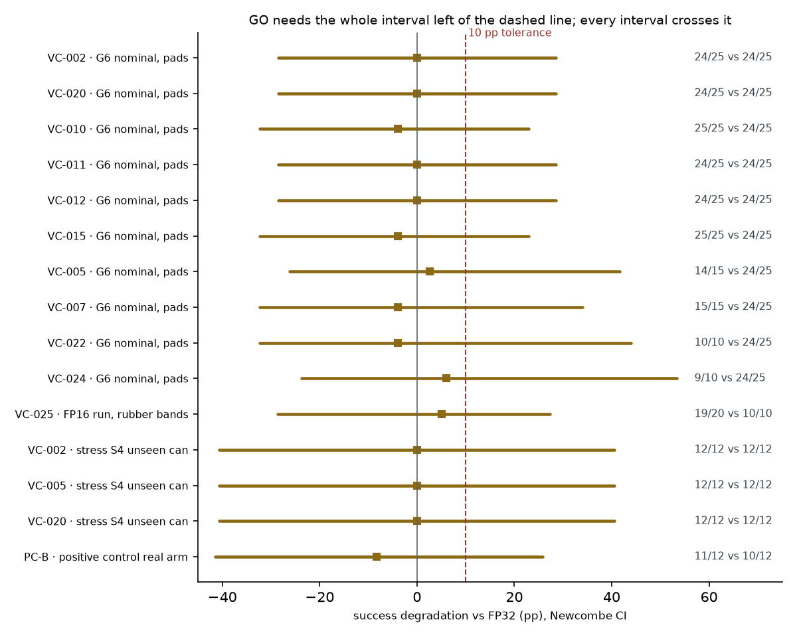
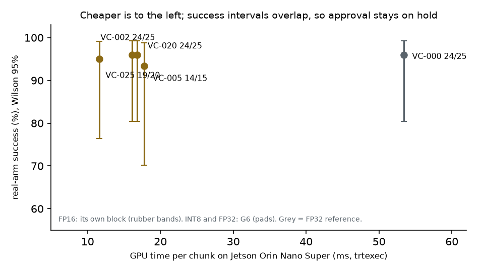
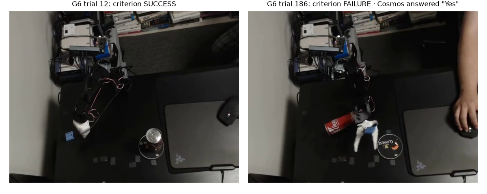
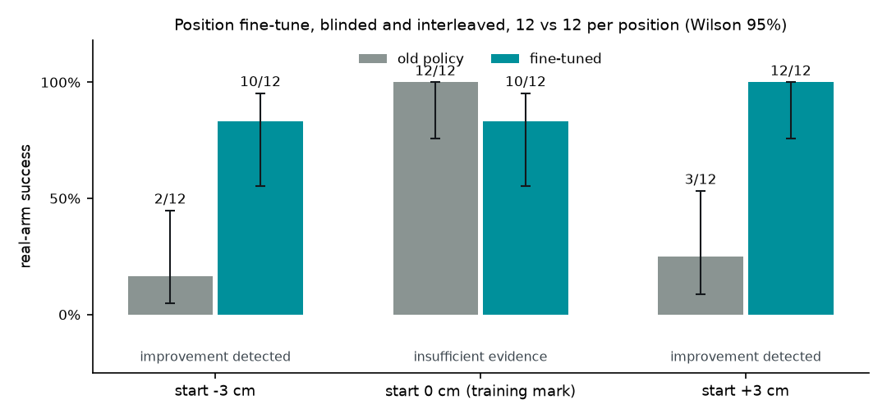

# QuantGate — deployment report v3 (auto-generated)

> Sections 1–4 are written by code from the verdict table (`d3_v3_verdicts.json`, hash `55f0eeb76289c82d`). Sections 5–6 are written by Nemotron 3 Super (Token Factory) and checked by code: no digits, no verdict labels, no approval or safety words. They are never a source of verdicts or numbers; a qualitative misreading in plain words cannot be excluded by these rules. v2 is kept as history (`d3_report_v2.md`).

| Item | Value |
|---|---|
| Model attempts | 1 |
| Latency | 35.3 s |
| **Wording findings (final attempt)** | **0** |

---

## 1. Recommendation (written by code)

FP16 is the recommended precision to validate first (cheapest on the device). The position fine-tune (FT-FP16, same FP16 engine cost) fixed the start-position weakness at both held-out shifts (IMPROVEMENT_DETECTED at +3 cm and -3 cm), so FT-FP16 is the candidate to validate next where start positions vary. Fine-tune v2 (FT2-FP16) then closed the two gaps the first fine-tune left, the yellow can and a start at +6 cm (IMPROVEMENT_DETECTED against FT-FP16 for both, in one session), so FT2-FP16 is the candidate to validate next for those conditions. Approval is a separate status: on hold, because every comparison against full precision is INSUFFICIENT_EVIDENCE and the fine-tunes' nominal performance is undecided.

## 2. Verdict per candidate (written by code)

Each success interval is a Newcombe interval for candidate minus reference, in percentage points; its confidence level and decision rule are printed on the row, because comparisons against full precision test non-inferiority (10 pp) and the fine-tune rows test improvement. End-to-end latency is the runner's per-chunk time on the arm; GPU time is trtexec on the device (15 W).

- **VC-002** · G6 nominal, pads · `INSUFFICIENT_EVIDENCE` · success 24/25 against reference 24/25 · candidate − reference +0.0 pp, 99.75% interval [-28.5, +28.5] pp (non-inferiority at a 10 pp tolerance: within tolerance if the lower bound is above -10 pp, degraded if the upper bound is below -10 pp, else undecided (the verdict also uses placement)) · placement: tolerance compatible · end-to-end 34.3 ms · GPU time on device 16.8 ms (`artifacts/reports/g6_q2_sensitivity.json#Q2.VC-002`)
- **VC-020** · G6 nominal, pads · `INSUFFICIENT_EVIDENCE` · success 24/25 against reference 24/25 · candidate − reference +0.0 pp, 99.75% interval [-28.5, +28.5] pp (non-inferiority at a 10 pp tolerance: within tolerance if the lower bound is above -10 pp, degraded if the upper bound is below -10 pp, else undecided (the verdict also uses placement)) · placement: tolerance compatible · end-to-end 34.3 ms · GPU time on device 16.8 ms (`artifacts/reports/g6_q2_sensitivity.json#Q2.VC-020`)
- **VC-010** · G6 nominal, pads · `INSUFFICIENT_EVIDENCE` · success 25/25 against reference 24/25 · candidate − reference +4.0 pp, 99.75% interval [-23.0, +32.3] pp (non-inferiority at a 10 pp tolerance: within tolerance if the lower bound is above -10 pp, degraded if the upper bound is below -10 pp, else undecided (the verdict also uses placement)) · placement: tolerance compatible · end-to-end 34.3 ms (`artifacts/reports/g6_q2_sensitivity.json#Q2.VC-010`)
- **VC-011** · G6 nominal, pads · `INSUFFICIENT_EVIDENCE` · success 24/25 against reference 24/25 · candidate − reference +0.0 pp, 99.75% interval [-28.5, +28.5] pp (non-inferiority at a 10 pp tolerance: within tolerance if the lower bound is above -10 pp, degraded if the upper bound is below -10 pp, else undecided (the verdict also uses placement)) · placement: tolerance compatible · end-to-end 34.6 ms (`artifacts/reports/g6_q2_sensitivity.json#Q2.VC-011`)
- **VC-012** · G6 nominal, pads · `INSUFFICIENT_EVIDENCE` · success 24/25 against reference 24/25 · candidate − reference +0.0 pp, 99.75% interval [-28.5, +28.5] pp (non-inferiority at a 10 pp tolerance: within tolerance if the lower bound is above -10 pp, degraded if the upper bound is below -10 pp, else undecided (the verdict also uses placement)) · placement: tolerance compatible · end-to-end 34.3 ms (`artifacts/reports/g6_q2_sensitivity.json#Q2.VC-012`)
- **VC-015** · G6 nominal, pads · `INSUFFICIENT_EVIDENCE` · success 25/25 against reference 24/25 · candidate − reference +4.0 pp, 99.75% interval [-23.0, +32.3] pp (non-inferiority at a 10 pp tolerance: within tolerance if the lower bound is above -10 pp, degraded if the upper bound is below -10 pp, else undecided (the verdict also uses placement)) · placement: indeterminate · end-to-end 34.6 ms (`artifacts/reports/g6_q2_sensitivity.json#Q2.VC-015`)
- **VC-005** · G6 nominal, pads · `INSUFFICIENT_EVIDENCE` · success 14/15 against reference 24/25 · candidate − reference -2.7 pp, 99.75% interval [-41.7, +26.2] pp (non-inferiority at a 10 pp tolerance: within tolerance if the lower bound is above -10 pp, degraded if the upper bound is below -10 pp, else undecided (the verdict also uses placement)) · placement: tolerance compatible · end-to-end 34.5 ms · GPU time on device 17.1 ms (`artifacts/reports/g6_q2_sensitivity.json#Q2.VC-005`)
- **VC-007** · G6 nominal, pads · `INSUFFICIENT_EVIDENCE` · success 15/15 against reference 24/25 · candidate − reference +4.0 pp, 99.75% interval [-34.0, +32.3] pp (non-inferiority at a 10 pp tolerance: within tolerance if the lower bound is above -10 pp, degraded if the upper bound is below -10 pp, else undecided (the verdict also uses placement)) · placement: tolerance compatible · end-to-end 34.6 ms (`artifacts/reports/g6_q2_sensitivity.json#Q2.VC-007`)
- **VC-022** · G6 nominal, pads · `INSUFFICIENT_EVIDENCE` · success 10/10 against reference 24/25 · candidate − reference +4.0 pp, 99.75% interval [-43.9, +32.3] pp (non-inferiority at a 10 pp tolerance: within tolerance if the lower bound is above -10 pp, degraded if the upper bound is below -10 pp, else undecided (the verdict also uses placement)) · placement: indeterminate · end-to-end 34.3 ms (`artifacts/reports/g6_q2_sensitivity.json#Q2.VC-022`)
- **VC-024** · G6 nominal, pads · `INSUFFICIENT_EVIDENCE` · success 9/10 against reference 24/25 · candidate − reference -6.0 pp, 99.75% interval [-53.4, +23.7] pp (non-inferiority at a 10 pp tolerance: within tolerance if the lower bound is above -10 pp, degraded if the upper bound is below -10 pp, else undecided (the verdict also uses placement)) · placement: tolerance compatible · end-to-end 34.1 ms (`artifacts/reports/g6_q2_sensitivity.json#Q2.VC-024`)
- **VC-025** · FP16 run, rubber bands · `INSUFFICIENT_EVIDENCE` · success 19/20 against reference 10/10 · candidate − reference -5.0 pp, 97.5% interval [-27.3, +28.7] pp (non-inferiority at a 10 pp tolerance: within tolerance if the lower bound is above -10 pp, degraded if the upper bound is below -10 pp, else undecided (the verdict also uses placement)) · placement: tolerance compatible · end-to-end 24.7 ms · GPU time on device 11.6 ms (`artifacts/reports/fp16_analysis.json#primary_fp16_vs_fp32`)
- **VC-002** · stress S4 unseen can · `INSUFFICIENT_EVIDENCE` · success 12/12 against reference 12/12 · candidate − reference +0.0 pp, 99.58% interval [-40.6, +40.6] pp (non-inferiority at a 10 pp tolerance: within tolerance if the lower bound is above -10 pp, degraded if the upper bound is below -10 pp, else undecided (the verdict also uses placement)) · placement: tolerance compatible · GPU time on device 16.8 ms (`artifacts/reports/stress_v2_analysis.json#S4.secondary_vs_fp32.VC-002`)
- **VC-005** · stress S4 unseen can · `INSUFFICIENT_EVIDENCE` · success 12/12 against reference 12/12 · candidate − reference +0.0 pp, 99.58% interval [-40.6, +40.6] pp (non-inferiority at a 10 pp tolerance: within tolerance if the lower bound is above -10 pp, degraded if the upper bound is below -10 pp, else undecided (the verdict also uses placement)) · placement: tolerance compatible · GPU time on device 17.1 ms (`artifacts/reports/stress_v2_analysis.json#S4.secondary_vs_fp32.VC-005`)
- **VC-020** · stress S4 unseen can · `INSUFFICIENT_EVIDENCE` · success 12/12 against reference 12/12 · candidate − reference +0.0 pp, 99.58% interval [-40.6, +40.6] pp (non-inferiority at a 10 pp tolerance: within tolerance if the lower bound is above -10 pp, degraded if the upper bound is below -10 pp, else undecided (the verdict also uses placement)) · placement: tolerance compatible · GPU time on device 16.8 ms (`artifacts/reports/stress_v2_analysis.json#S4.secondary_vs_fp32.VC-020`)
- **PC-B** · positive control real arm · `INSUFFICIENT_EVIDENCE` · success 11/12 against reference 10/12 · candidate − reference +8.3 pp, 97.5% interval [-25.8, +41.5] pp (non-inferiority at a 10 pp tolerance: within tolerance if the lower bound is above -10 pp, degraded if the upper bound is below -10 pp, else undecided (the verdict also uses placement)) · placement: tolerance compatible · end-to-end 34.5 ms (`artifacts/reports/positive_control_analysis.json#comparison`)
- **FT-FP16** · fine-tune vs old, start +3 cm (held out, primary) · `IMPROVEMENT_DETECTED` · success 12/12 against VC-025 (old policy) 3/12 · candidate − reference +75.0 pp, 95% interval [+37.8, +91.1] pp (improvement detected if the lower bound is above 0) · GPU time on device 11.6 ms (`artifacts/reports/ft_analysis.json#T1.primary`)
- **FT-FP16** · fine-tune vs old, start -3 cm (held out, symmetry) · `IMPROVEMENT_DETECTED` · success 10/12 against VC-025 (old policy) 2/12 · candidate − reference +66.7 pp, 95% interval [+26.9, +83.6] pp (improvement detected if the lower bound is above 0) · GPU time on device 11.6 ms (`artifacts/reports/ft_analysis.json#T2.primary`)
- **FT-FP16** · fine-tune vs old, training start mark (secondary) · `INSUFFICIENT_EVIDENCE` · success 10/12 against VC-025 (old policy) 12/12 · candidate − reference -16.7 pp, 97.5% interval [-49.0, +15.4] pp (non-inferiority at a 10 pp tolerance: within tolerance if the lower bound is above -10 pp, degraded if the upper bound is below -10 pp, else undecided (the verdict also uses placement)) · placement: indeterminate · GPU time on device 11.6 ms (`artifacts/reports/ft_analysis.json#T0.secondary`)
- **FT-FP16** · fine-tune vs old, training start mark, T0 + T0R pooled (replication) · `INSUFFICIENT_EVIDENCE` · success 22/24 against VC-025 (old policy) 23/24 · candidate − reference -4.2 pp, 97.5% interval [-25.3, +16.3] pp (non-inferiority at a 10 pp tolerance: within tolerance if the lower bound is above -10 pp, degraded if the upper bound is below -10 pp, else undecided (the verdict also uses placement)) · placement: indeterminate · GPU time on device 11.6 ms (`artifacts/reports/ft3_analysis.json#pooled_T0_T0R`)
- **FT2-FP16** · fine-tune v2 vs fine-tune, yellow can at +3 cm (held out, primary) · `IMPROVEMENT_DETECTED` · success 12/12 against FT-FP16 (first fine-tune) 7/12 · candidate − reference +41.7 pp, 95% interval [+8.7, +68.0] pp (improvement detected if the lower bound is above 0) (`artifacts/reports/ft6_analysis.json#TYP2.test`)
- **FT2-FP16** · fine-tune v2 vs fine-tune, start +6 cm (held out, secondary) · `IMPROVEMENT_DETECTED` · success 12/12 against FT-FP16 (first fine-tune) 2/12 · candidate − reference +83.3 pp, 95% interval [+46.2, +95.3] pp (improvement detected if the lower bound is above 0) (`artifacts/reports/ft6_analysis.json#T6P2.test`)

## 3. Flagged builds (written by code)

- **PC-N** · offline, deliberately miscalibrated · `FLAGGED` by simple input check, action error (MSE), audit score (magnitude), audit score (alignment) (`artifacts/reports/simple_checks_vs_audit.json#cells.PC-N`)
- **PC-B** · offline, deliberately miscalibrated · `FLAGGED` by simple input check, action error (MSE), audit score (magnitude), audit score (alignment) (`artifacts/reports/simple_checks_vs_audit.json#cells.PC-B`)

The action-MSE and audit-score thresholds were set on the same 24 normal cells, so '0 normal cells flagged' holds by construction; only the input check is independent of that set.

AI judge: Cosmos-Reason2 end-of-trial judge, held-out eval of 273 recorded trials (artifacts/cosmos_judge/eval_scores.jsonl): first setup 1/21 failures caught; validated prompt C1 p1 20/21 caught, 5/252 false alarms, 4 of them on the unseen yellow can (4/33). Wording-sensitive; end state only. Re-checked live and prospectively in the fine-tune evaluation (96 new trials, T1/T0/T2/T0R): 22/24 failures caught, 2/72 false alarms (artifacts/reports/ft_cosmos_live_judge.json; T0R in ft3_analysis).

## 4. Next actions (written by code)

- **More trials alone will not settle this: under the pre-registered ceiling rule, two arms both at or above 95 percent stay undecided at any sample size. Settling it needs a revised, pre-registered rule (for example a bound on the failure-rate difference); about 110-120 trials per arm would then give a 10 pp interval (planning estimate, not a guarantee)** — VC-002 (G6 nominal, pads), VC-020 (G6 nominal, pads), VC-010 (G6 nominal, pads), VC-011 (G6 nominal, pads), VC-012 (G6 nominal, pads), VC-015 (G6 nominal, pads), VC-007 (G6 nominal, pads), VC-022 (G6 nominal, pads), VC-002 (stress S4 unseen can), VC-005 (stress S4 unseen can), VC-020 (stress S4 unseen can)
- **Settle success against FP32 at 10 pp: plan about 110-120 trials per arm (planning estimate, assumes equal true rates near 96-97 percent; not a guarantee)** — VC-005 (G6 nominal, pads), VC-024 (G6 nominal, pads)
- **More trials alone will not settle this: under the pre-registered ceiling rule, two arms both at or above 95 percent stay undecided at any sample size. Settling it needs a revised, pre-registered rule (for example a bound on the failure-rate difference); about 110-120 trials per arm would then give a 10 pp interval (planning estimate, not a guarantee); also validate start-position changes before deployment** — VC-025 (FP16 run, rubber bands)
- **Do not deploy; fix the calibration input (a simple input check catches it); see the real-arm check of PC-B** — PC-N (offline, deliberately miscalibrated), PC-B (offline, deliberately miscalibrated)
- **Offline warning not confirmed on the arm in 12 trials (unresolved, not 'tolerated'); keep rejecting this build at the calibration-input check; do not read the offline audit as a predictor of closed-loop failure** — PC-B (positive control real arm)
- **The candidate to validate next where the start position varies, not yet a replacement: settle the training mark, then confirm at more positions and objects** — FT-FP16 (fine-tune vs old, start +3 cm (held out, primary)), FT-FP16 (fine-tune vs old, start -3 cm (held out, symmetry))
- **Nominal performance at the training mark is still undecided (pooled with the T0R replication: 22/24 vs 23/24); the two T0 failures did not repeat in 12 more trials. Plan a larger block at the training mark before replacing the old policy there** — FT-FP16 (fine-tune vs old, training start mark (secondary)), FT-FP16 (fine-tune vs old, training start mark, T0 + T0R pooled (replication))
- **The candidate to validate next for the yellow can and starts up to +6 cm, not yet a replacement: a training-mark guard showed no drop in 12 trials; settle the training mark against the old policy, then test more objects and positions** — FT2-FP16 (fine-tune v2 vs fine-tune, yellow can at +3 cm (held out, primary)), FT2-FP16 (fine-tune v2 vs fine-tune, start +6 cm (held out, secondary))

## 5. Why the review looks like this
The sixteen-bit floating point candidate is chosen for initial validation because it delivers the lowest energy per inference and the shortest latency on the device, even though it draws more power while running than the eight-bit integer builds.  
The position fine‑tune removed the start‑position weakness at both held‑out shifts of plus three centimeters and minus three centimeters, showing a clear improvement, but it has not yet demonstrated nominal performance at the training mark, which remains undecided.  
Success comparisons with full precision cannot be settled yet because both arms achieve high success rates that trigger the pre‑registered ceiling rule, leaving the outcome undecided no matter how many trials are added; a new rule must be introduced to resolve the comparison.  
Deliberately miscalibrated builds are stopped at the input check because a simple input check detects the calibration error and flags them before any further testing proceeds.  
The AI judge’s record shows it is wording‑sensitive, looks only at the end state, produces more false alarms on novel objects, was re‑checked on live fine‑tune trials and performed well there, but still requires additional validation on other objects and scenes before it can be relied upon.  

## 6. Questions to resolve before deployment
- How many trials are required to narrow the confidence interval around the success difference at the training mark to within ten percentage points so that the undecided verdict can be resolved?  
- Does the improvement observed at plus three centimeters and minus three centimeters persist when the start position is varied across a broader range of values?  
- Will the AI judge maintain a low false‑alarm rate when presented with objects that were not included in the fine‑tune evaluation set?

## Figures (drawn by code from the verdict table)

*Success vs FP32 per candidate: every Newcombe interval crosses the 10 pp tolerance, so no GO yet.*

*GPU time on the device vs real-arm success: FP16 is cheapest; success intervals overlap.*

*The frames behind two verdicts: a success, and a failure that Cosmos's first setup called a success.*

*Position fine-tune: fine-tuned vs old policy at -3 and +3 cm (12 vs 12 each) and at the training mark (T0 + T0R pooled, 24 vs 24); interleaved under sealed schedules, operator blinding partial.*

